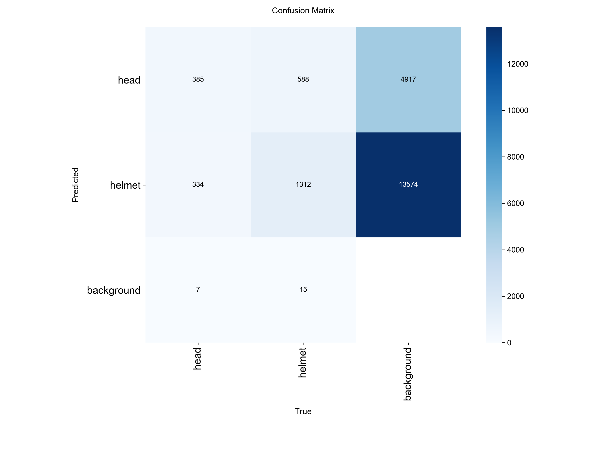
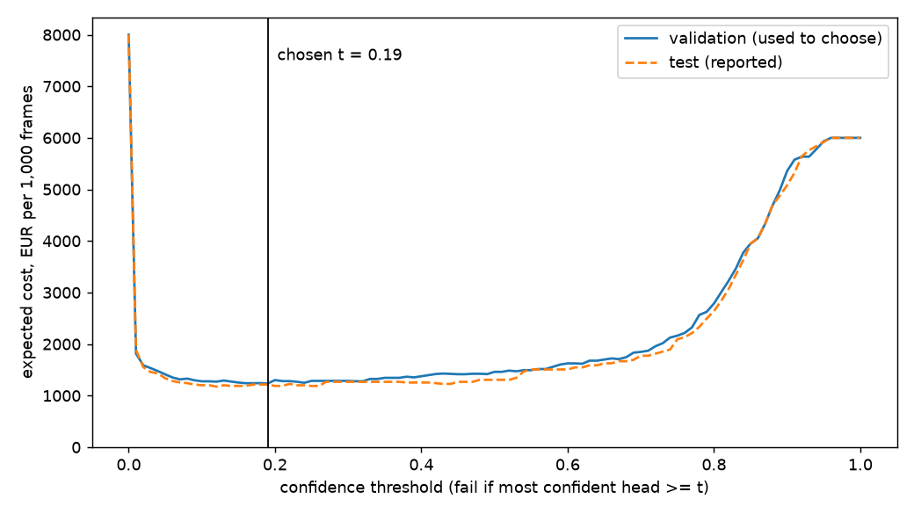

# Assignment 2 Report

- **Name**: Eva Yang Garrudo Salvador
- **Student ID**: 20207
- **Email**: egarrudo.ieu2022@student.ie.edu
- **Group**: BBADBA 5A

## Business problem, and the cost of being wrong

**The decision.** A mid-size construction site has cameras over its work areas. Today a supervisor walks the
site, or glances at the camera screens, to spot workers without a hard hat, and sends someone over to tell
them to put it on. The model looks at each camera frame and decides one of three things:

- **pass**: nothing happens;
- **human review**: a safety officer looks at the frame on a screen and decides;
- **fail**: a supervisor is sent to the worker straight away.

**Who acts on it.** The site safety officer, who does the reviews, and the site supervisors, who go to the worker.

**Positive class.** A frame is *positive* when it contains at least one worker without a helmet, a `head`
box in the data. The model's score for a frame is the confidence of its most confident `head` box.

**The two mistakes are not worth the same.**

- **False negative (missed bare head), about EUR 120.** The worker keeps working unprotected until someone
  notices. Two things can go wrong:
  - *A fine.* Not enforcing PPE is a serious infraction under Spain's LISOS, with a minimum fine of about
    EUR 2,451. If an inspector would see roughly 2% of uncorrected violations, that is about EUR 49 per miss.
  - *An injury.* If roughly 1 in 1,000 uncorrected bare-head exposures ends in a serious head injury, at about
    EUR 60,000 (sick leave, the employer's *recargo de prestaciones*, delays), that is about EUR 60 per miss.

  Add a little for the signal it sends to the rest of the crew, and the total is about **EUR 120**.
- **False positive (false alarm), about EUR 8.** A supervisor walks over for nothing: about 10 minutes at a
  loaded EUR 40/h, plus the interrupted worker's time. A *true* alarm costs the same EUR 8, because someone
  still has to walk over, but it prevents the EUR 120.
- **True negative: EUR 0.**

So **a miss costs about 15 times a false alarm**. That ratio drives everything below. It means we should
accept many false alarms to avoid one miss, so the operating point sits at **high recall** and the threshold
is low. The individual euro figures are rough. What matters for the threshold is mostly the ratio, and the
sensitivity check below shows how far it can move before the decision changes.

**Human review costs EUR 0.17 a frame.** A safety officer needs about 20 s to check one frame on screen,
at EUR 30/h. I assume the reviewer catches 95% of bare heads (heads can be tiny and far away), and sends
someone needlessly on 2% of compliant frames.

**Base rate: 5%.** On a site that already has a helmet rule, I assume about 1 frame in 20 shows a worker
without a helmet. This is **not** the dataset's rate (about 19% of images have a bare head, because the
dataset was collected to have them). All costs below are re-weighted to 5%, by measuring the model's rates
separately on positive and negative frames and mixing them at 5%.

## Dataset

- **Roboflow Universe**: workspace `joseph-nelson`, project `hard-hat-workers`, **version 5**,
  <https://universe.roboflow.com/joseph-nelson/hard-hat-workers/dataset/5>. Public domain, used as is, not forked.
- **Task**: object detection with **2 classes**: `head` (a head without a helmet) and `helmet` (a head with a
  helmet). Version 5 drops the project's third class, `person`, which has only 615 labels in the whole
  project and does not tell compliant from non-compliant workers.
- **One image** is a photo of one or more workers, usually on or near a site.

It serves the decision because what we need to spot, a bare head among helmeted heads, is exactly what is
labelled. A dataset with only "person" or only "helmet" boxes could not tell compliant from non-compliant workers.

## What the dataset's composition implies

| split | images | `head` boxes | `helmet` boxes | images with a bare head |
|---|---|---|---|---|
| train | 4,916 | 4,612 | 13,919 | 911 (18.5%) |
| valid | 1,413 | 1,339 | 3,913 | 256 (18.1%) |
| test | 706 | 726 | 1,915 | 140 (19.8%) |

**Object size.** The median `head` box covers **0.6% of the image**, and **72% of heads cover less than 1%**.
Helmets are similar (median 0.8%; 56% under 1%). Images are small, about 500×333 px.

What this means:

1. **Class balance is uneven but usable.** There are 3 helmets for every bare head. With 726 bare heads in test,
   per-class box numbers are trustworthy to a few points. But the frame-level decision rests on only
   **140 positive test images**, so a recall of 0.90 carries a 95% interval of roughly ±5 points. Small
   differences between thresholds should not be over-read.
2. **Tiny objects are the main difficulty.** Most heads are a few dozen pixels across, so the model will miss
   small, distant heads first. This matters because a real site camera is usually *further* away than these photos.
3. **The test split does not look like production.** These are mostly web and stock photos of workers, framed
   by a photographer, not fixed CCTV frames from above, at night, in rain or with motion blur. Every number
   below holds for *this kind of photo*. Before trusting it on a real site we would need to label a few hundred
   frames from that site's own cameras.
4. **The base rate is wrong for production** (19% here against an assumed 5%). That is why costs are
   re-weighted rather than read straight off the test confusion matrix.
5. **The splits are consistent with each other.** All three have 18–20% positive images and the same object
   sizes, so validation is a fair place to choose thresholds before reporting on test.

## Finetuning and baselines

**Model.** `yolo11n` (detection), finetuned from the COCO checkpoint. I chose detection rather than
classification because the evidence is a small region of the image, and because a box shows the reviewer
*where* to look. I chose the nano model because it can be trained on the laptop available.

**Where and how it was trained.** On my own laptop, a MacBook with an Apple M1 and **8 GB of memory**, using its GPU (PyTorch `mps`).
Settings: `yolo11n.pt` from COCO, **6 epochs**, image size **416**, batch **8**, seed 0, Ultralytics defaults
otherwise (AdamW, early-stopping patience 10). Training took about 1 h 40 min. The settings are small on
purpose: at 640 px and batch 16 the laptop ran out of memory and slowed to about 35 minutes an epoch. The
images are only about 500 px wide, so 416 loses little detail. On a GPU, `train.py` uses 25 epochs and batch 16.

The best epoch was the last one (validation mAP50 0.93). The run evaluates on the CPU after training,
because evaluating on the 8 GB laptop's GPU filled its memory. The first run's evaluation was stopped for
that reason, and the evaluation was re-run on the same saved weights with `EVAL_ONLY=1 python main.py train`.
A plain `python main.py train` always trains from scratch.

**Baselines, on the same test split:**

- **COCO zero-shot**: the pretrained `yolo11n`, with no finetuning. COCO has no helmet or head class. Its
  nearest concept is `person`, so every person box is read as a `head` (the most generous reading). For the
  frame decision, its score is its most confident person.
- **Predict nothing**: no boxes at all. At frame level, every frame passes, which is the majority class
  (80% of test images have no bare head).

| model | mAP50 | mAP50-95 | `head` AP50 | `helmet` AP50 | frame ROC AUC | EUR / 1,000 frames at t = 0.19 | bare-head frame recall | false-alarm rate |
|---|---|---|---|---|---|---|---|---|
| **finetuned yolo11n** | **0.943** | **0.632** | **0.926** | **0.961** | **0.951** | **1,215** | **0.886** | **0.023** |
| COCO yolo11n, zero-shot | 0.003 | 0.001 | 0.005 | 0.000 | 0.607 | 7,772 | 1.000 | 0.970 |
| predict nothing | 0.000 | 0.000 | 0.000 | 0.000 | 0.500 | 6,000 | 0.000 | 0.000 |

*(AP computed by my own code on the test split. Ultralytics' own test evaluation gives mAP50 0.950 and
mAP50-95 0.636. The small gap comes from how the two interpolate the precision curve.)*

**What changed.** The finetuned model beats both baselines by a wide margin, and the gap is as large as
expected. The COCO model has no idea what a helmet is. Its person boxes cover the whole body, so they never
overlap a head box enough to count (AP ≈ 0). At frame level it simply says "there is a person", which is true
of almost every frame, so it raises the alarm on 97% of compliant frames. That makes it **more expensive
than doing nothing** (EUR 7,772 against EUR 6,000 per 1,000 frames). Predicting nothing is right 80% of the
time on the test split, yet misses every bare head. Accuracy would rank it highly, and the cost shows why
that ranking is wrong.

## Per-class evaluation and failure modes

Positive class: **`head`** (a worker without a helmet).

**Box level, threshold-free (Ultralytics, test split):**

| class | test boxes | precision | recall | AP50 | AP50-95 |
|---|---|---|---|---|---|
| `head` (positive) | 726 | 0.925 | 0.879 | 0.940 | 0.628 |
| `helmet` | 1,915 | 0.925 | 0.902 | 0.960 | 0.643 |
| all | 2,641 | | | 0.950 | 0.636 |

**Box level, at the chosen threshold of 0.19** (own matching, IoU 0.5):

| class | precision | recall | true boxes found | false boxes | missed boxes |
|---|---|---|---|---|---|
| `head` | 0.851 | 0.927 | 673 | 118 | 53 |
| `helmet` | 0.822 | 0.944 | 1,808 | 392 | 107 |

**Frame level at t = 0.19, test split (the number the decision runs on):**

| | predicted: no bare head | predicted: bare head |
|---|---|---|
| **truth: no bare head** (566) | 553 | 13 (false alarms, 2.3%) |
| **truth: bare head** (140) | 16 (missed, 11.4%) | 124 (recall 0.886) |

**Which class carries the headline number.** `helmet` carries it (AP50 0.96 on 1,915 boxes). The class
the decision depends on, `head`, is weaker (0.94) and has fewer than half as many boxes. The mean flatters us:
the class we care about is the worse one.

**Where it breaks.** Matching every true head box at t = 0.19:

| true class | found as `head` | found as `helmet` | missed entirely |
|---|---|---|---|
| `head` (726) | 667 | **26** | 33 |
| `helmet` (1,915) | 5 | 1,806 | 104 |

1. **Non-safety headwear read as a helmet (the dangerous error).** 26 bare heads are boxed as `helmet`. In the
   missed frames I inspected, the cause was a person wearing *some other* hat (for example a brimmed hat),
   which the dataset correctly labels as a bare head. The model has learned
   "something on the head" more than "a hard hat". This is a false negative that looks confident, so a review
   band cannot catch it.
2. **Tiny, distant heads.** The model finds 95% of bare heads larger than 1% of the image and 94% of those
   between 0.25% and 1%, but only **74% of the 81 tiniest** (under 0.25%). Real site cameras are mounted further
   away than these photos, so this failure will be *more* common in production than on the test split.
3. **Label noise makes the false alarms look worse than they are.** The two most confident "false alarms"
   (scores 0.88 and 0.86) show clearly visible bare heads that the dataset simply did not label. Some of the
   118 "false" head boxes are really missing labels, so the true precision is somewhat higher than 0.85.
   I did not relabel them, because the brief says to use the dataset as it is.
4. **Helmets are missed more than confused.** 104 helmets are missed, mostly tiny or partly hidden ones. That
   does not hurt the decision, because a missed helmet raises no alarm and causes no miss.

## Cost matrix and operating point

| | cost | where it comes from |
|---|---|---|
| false negative (missed bare head) | EUR 120 | about EUR 49 expected fine + about EUR 60 expected injury + a small norm-setting allowance |
| true positive (supervisor sent, needed) | EUR 8 | 10 min of supervisor time + the worker's interruption |
| false positive (supervisor sent, not needed) | EUR 8 | the same walk, for nothing |
| true negative | EUR 0 | |
| human review of one frame | EUR 0.17 | 20 s at EUR 30/h; the reviewer catches 95% and wrongly escalates 2% |
| base rate | 5% | a site with a helmet rule; the dataset's 19% is an artefact of how it was collected |

**Method.** For every threshold *t* from 0 to 1 in steps of 0.01, a frame *fails* if its most confident bare
head is at or above *t*. I measure recall and false-alarm rate on the **validation** split, re-weight to a 5%
base rate, and compute the expected cost per 1,000 frames. I pick the cheapest *t* on validation and then
report it on **test**, so the threshold is not fitted to the numbers I report.

**Result.** The cheapest single threshold on validation is **t = 0.19**. On test it gives recall 0.886 and a
2.3% false-alarm rate, at an expected **EUR 1,215 per 1,000 frames**.

- The curve is **flat between about 0.10 and 0.25** (test: EUR 1,188 to 1,202), so the exact value matters
  little. Above 0.5 it rises steeply, because recall starts to fall and each lost bare head costs EUR 120.
  This shape follows from the 15:1 cost ratio: false alarms are cheap, so it pays to keep the threshold low.
- The validation curve and the test curve agree closely, so the threshold is not over-fitted to validation.

**Sensitivity: what would change the answer.** I re-ran the sweep while moving one assumption at a time:

| assumption | value | cheapest t |
|---|---|---|
| cost of a miss | EUR 10 | 0.81 |
| | EUR 25 | 0.53 |
| | EUR 50 | 0.24 |
| | **EUR 120 (chosen)** | **0.19** |
| | EUR 250 | 0.16 |
| | EUR 500 | 0.06 |
| base rate | 2% | 0.24 |
| | **5% (chosen)** | **0.19** |
| | 10% | 0.16 |
| | 20% | 0.02 |

For any miss cost between EUR 50 and EUR 250, and any base rate between 2% and 10%, the threshold stays between
0.16 and 0.24, so the decision is robust to my rough euro figures. **The answer changes if a miss costs less than
about EUR 25**, roughly three supervisor walks. Then the threshold jumps above 0.5 and the model should alarm
far less. The assumption that would most change the answer is therefore the cost of a miss, and in particular
the injury probability inside it.

## What a person still has to check

**Volume.** 8 cameras, one frame every 2 minutes, over a 10-hour shift = **2,400 frames a day**.

**Capacity.** One safety officer can realistically spend about **2 hours a day** on the review queue. At
20 s a frame that is 360 frames, or **15% of frames**. I searched every pair of thresholds (t_low, t_high) on
validation for the cheapest one that sends at most 15% of frames to review.

**Chosen thresholds:**

- **fail** (send a supervisor) if the most confident bare head is **≥ 0.76**;
- **human review** if it is **between 0.01 and 0.76**;
- **pass** if the model sees no bare head at all, even at 0.01.

The fail threshold is high because a dispatch with no human check should only happen when the model is sure.
Everything the model has *any* suspicion about goes to a person, who is cheap (EUR 0.17).

**On the test split:**

| truth | pass | review | fail |
|---|---|---|---|
| no bare head (566) | 488 | 74 | 4 |
| bare head (140) | **11** | 31 | 98 |

Only 11 of 140 bare-head frames slip through, against 16 when the model decides alone. False dispatches drop
from 13 to 4.

**The review load.** About **13.5% of frames** go to a person: **about 325 frames a day**, at 20 s each that is
**1.8 hours**, which is about a quarter of one person's 7 productive hours. One safety officer can do it, alongside
their other work. **This is realistic.**

**Priced against the alternatives** (expected EUR per 1,000 frames at a 5% base rate; test split):

| policy | EUR per 1,000 frames | per day (2,400 frames) | person-hours of review a day |
|---|---|---|---|
| do nothing | 6,000 | 14,400 | 0 |
| model decides alone (t = 0.19) | 1,215 | 2,916 | 0 |
| a person checks every frame | 1,002 | 2,405 | 13.3 (about 2 full-time people) |
| **model + review band (0.01 / 0.76)** | **999** | **2,397** | **1.8** |
| *band with no capacity limit (review 96%)* | *852* | *2,045* | *12.8* |

How to read this:

- **The model alone already removes about 80% of the cost of doing nothing.** Missed bare heads are what make
  doing nothing expensive.
- **The review band costs the same as checking everything, with about one seventh of the reviewing.** In euros
  it ties with "a person checks every frame", but that option needs about 13 hours of screen-watching a day,
  which means two extra hires that do not exist. The band reaches the same cost with 1.8 hours.
- **Without a capacity limit, the cheapest design reviews almost everything.** Review is so cheap per frame
  (EUR 0.17) next to a miss (EUR 120) that the sweep then sends 96% of frames to a person. That is cheaper on
  paper (EUR 852) but needs 12.8 hours a day. **Capacity, not the euro figure, is the binding constraint**,
  which is why the chosen band is the capacity-limited one.

## Limitations & next steps

1. **The test photos are not CCTV frames.** They are framed stock and news photos, close up and in daylight.
   *Fix:* label 300 to 500 frames from the site's own cameras (night, rain, high angle), measure recall on
   those, and re-run the threshold sweep before going live.
2. **Non-safety hats are read as helmets.** This is the costliest error, and a review band cannot catch it
   because the model is confident. *Fix:* add a `non-safety hat` class with a few hundred examples (caps, hoods,
   sun hats), or crop each `helmet` box and pass it to a small classifier for "hard hat or not".
3. **Tiny heads are missed (74% recall below 0.25% of the frame).** *Fix:* train at 640 px or with tiled
   inference on a GPU. The laptop forced 416 px and 6 epochs, and validation mAP was still rising at the end,
   so more epochs alone would likely help.
4. **The euro figures are estimates, not data.** The injury probability is the weakest number. *Fix:* replace
   it with the company's own incident and inspection history. The sensitivity table shows the decision holds
   unless a miss is worth under about EUR 25.
5. **The labels are noisy.** Some bare heads are unlabelled, which understates precision. *Fix:* review the
   highest-scoring "false alarms" in the test split and correct the labels, at least for evaluation.
6. **Frames are treated as independent.** In reality the same worker appears in many consecutive frames.
   *Fix:* raise an alarm only when a bare head persists across 2 or 3 frames. That would cut false dispatches
   further and makes a single missed frame less costly.

## Generative AI use disclosure

I used Claude (Anthropic) as a coding and writing assistant. It wrote `train.py`, `costs.py` and `app.py`
and drafted this report from the pipeline's outputs. I chose the problem (hard-hat compliance), and I have
gone through each cost assumption, the threshold choice and the review-load calculation so that I can
explain them myself.
